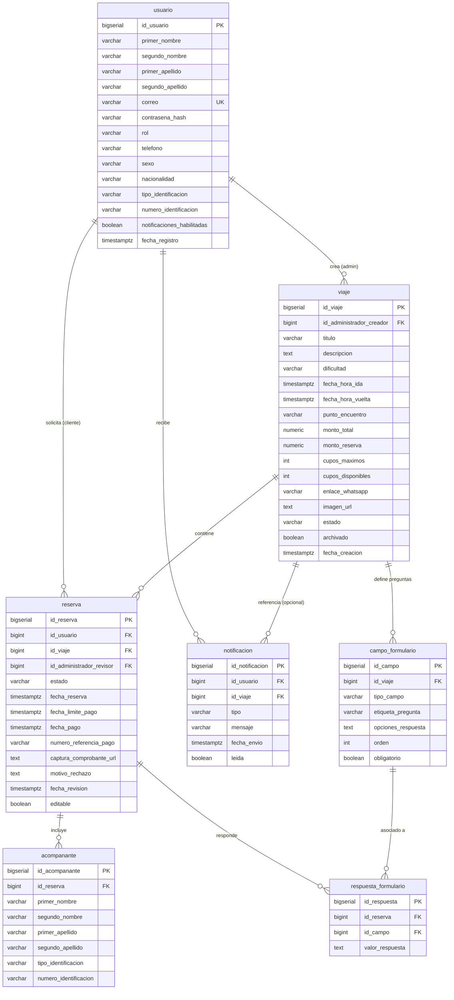

# Documentación Técnica Integral del Sistema — Versión Beta
**Club Nicaragüense de Montañismo (CNM)**  
*Fecha de consolidación: Octubre 2026*  
*Versión: Beta (Consolidación de Arquitectura, Storage Cloud, Notificaciones y Archivo Lógico)*

---

## 1. Introducción y Estado del Proyecto (Fase Beta)

La plataforma del **Club Nicaragüense de Montañismo (CNM)** ha alcanzado el hito de **Versión Beta**. En esta fase se superaron las limitaciones del MVP inicial (mocks, datos estáticos y acoplamientos rígidos) para dar paso a un sistema completamente reactivo, distribuido y persistente donde el cliente Next.js 16 interactúa bidireccionalmente con el backend Spring Boot 3, soportado por una base de datos relacional PostgreSQL (Supabase) y almacenamiento en la nube de objetos con políticas de seguridad RLS.

Este documento consolida la arquitectura implementada, el stack tecnológico completo, los endpoints REST disponibles, el esquema de datos relacional (destacando las transformaciones de V1 a V8) y los contrastes y decisiones técnicas tomadas a lo largo de la integración entre Frontend y Backend.

---

## 2. Arquitectura General del Sistema

El ecosistema opera bajo un modelo desacoplado **Cliente-Servidor (SPA / SSR Híbrido + API RESTful)**:

```
+-----------------------------------------------------------------------------------+
|                                 CAPA CLIENTE (FRONTEND)                           |
|  Next.js 16 (App Router) + React 19 + TypeScript + Tailwind CSS 4                |
|                                                                                   |
|  - Catálogo Público (/viajes, /viajes/[id])                                      |
|  - Flujo de Inscripción y Pago 4 Pasos (/inscripcion/[idViaje])                  |
|  - Panel del Cliente (/user/reservas, /user/perfil, /user/notificaciones)         |
|  - Panel de Administración (/admin/viajes, /admin/reservas, /admin/usuarios)     |
|  - MensajesContext (Sistema Global de Notificaciones Pop Up)                      |
|  - MarkdownRenderer & MarkdownEditor                                              |
+--------------------------+------------------------------+-------------------------+
                           |                              |
           HTTPS / JSON    |                              | Upload Directo (Blobs)
        Bearer JWT Auth    |                              | Políticas RLS
                           v                              v
+--------------------------------------+      +-------------------------------------+
|        CAPA SERVICIOS (BACKEND)      |      |      STORAGE EN LA NUBE (SUPABASE)  |
|  Spring Boot 3 + Java 21 + Security  |      |  - Bucket 'cnm-files' (imágenes)    |
|                                      |      |  - Bucket 'capturas-comprobantes'   |
|  - Controllers REST (/api/v1/...)    |      |  - Bucket 'user-entries-files'      |
|  - Servicios Transaccionales (@Tx)   |      +-------------------------------------+
|  - Repositorios Spring Data JPA      |
|  - Filtro JWT + Bcrypt Passwords     |
|  - Jakarta Mail (SMTP Gmail TLS 587) |
|  - Flyway Migrations (V1 -> V8)      |
+--------------------------+-----------+
                           |
            Conexión JDBC  | PostgreSQL 15+
                           v
+-----------------------------------------------------------------------------------+
|                             BASE DE DATOS RELACIONAL                              |
|  PostgreSQL / Supabase (Tablas: usuario, viaje, reserva, acompanante,             |
|                         campo_formulario, respuesta_formulario, notificacion)     |
+-----------------------------------------------------------------------------------+
```

### 2.1 Flujo de Autenticación y Autorización
1. **Credenciales Propias (Local)**:
   - Registro vía `POST /auth/registro` (contraseña hasheada con BCrypt).
   - Login vía `POST /auth/login`, emitiendo un token **JWT** firmado con HMAC-SHA256 y vigencia de 24 horas.
2. **Google OAuth (Federado)**:
   - El cliente inicia sesión contra Supabase OAuth / Google Identity Services (`POST /auth/google`).
   - El backend valida la identidad federada, crea o enlaza el usuario y emite un token de sesión unificado.
3. **Consumo de la API**:
   - Cada petición protegida del frontend viaja a través del cliente tipado `ApiClient` inyectando el header `Authorization: Bearer <token>`.
   - El backend valida el token mediante `JwtAuthenticationFilter`, mapeando el contexto de seguridad en `SecurityContextHolder`.

---

## 3. Stack Tecnológico y APIs Integradas

### 3.1 Frontend
- **Framework Principal**: Next.js 16.3.0 (Arquitectura App Router, Server Components y Client Components según interactividad).
- **Librería UI**: React 19.2.8.
- **Tipado Estricto**: TypeScript 5.9.
- **Estilos**: Tailwind CSS 4.0 (con CSS variables y tokens temáticos adaptativos).
- **Iconografía**: Lucide React 1.59.0.
- **Animaciones**: Lottie React 3.1.2.
- **Testing**: Node.js Native Test Runner (`node:test`, `node:assert/strict`) con cargador ES Module (`test/loader.mjs`).

### 3.2 Backend
- **Lenguaje**: Java 21 LTS.
- **Framework**: Spring Boot 3.3.4.
  - `spring-boot-starter-web`: Exposición de endpoints REST y negociación de contenido JSON.
  - `spring-boot-starter-data-jpa`: Capa de abstracción relacional con Hibernate 6.
  - `spring-boot-starter-security`: Filtros de seguridad, autenticación stateless y RBAC.
  - `spring-boot-starter-validation`: Validación declarativa de DTOs con Hibernate Validator.
  - `spring-boot-starter-mail`: Envío de correos electrónicos transaccionales (implementación Angus Mail).
- **Migraciones de BD**: Flyway Migration (V1 a V8).
- **Tokens**: `io.jsonwebtoken (jjwt-api, jjwt-impl, jjwt-jackson)` versión 0.12.6.
- **Entorno**: `io.github.cdimascio:dotenv-java:3.0.0` para desacoplamiento estricto de secretos.

### 3.3 Servicios y APIs Externas
1. **Supabase Storage API**:
   - `cnm-files`: Galería general de presentaciones e imágenes oficiales del club.
   - `capturas-comprobantes`: Comprobantes bancarios de reserva en la ruta `images/` (subida directa vía binario, eliminando Base64).
   - `user-entries-files`: Documentos y adjuntos dinámicos enviados por los usuarios en formularios de viaje (ruta `files/`, con políticas públicas de inserción y lectura RLS).
2. **Google Identity Services / Supabase Auth**:
   - Proveedor de identidad OAuth2 para inicio de sesión en 1 clic.
3. **Google SMTP Gateway (`smtp.gmail.com:587`)**:
   - Conexión segura con STARTTLS para el despacho asíncrono de correos HTML con plantillas personalizadas (felicitación + enlace a WhatsApp en aprobaciones; justificación de rechazo y contacto oficial en declinaciones).

---

## 4. Catálogo Exhaustivo de Endpoints REST

A continuación se detalla la totalidad de los endpoints operativos del Backend (`/api/v1`):

### 4.1 Módulo de Autenticación (`/auth`)

| Método | Endpoint | Rol Requerido | Descripción | DTO Entrada | DTO Salida |
| :--- | :--- | :--- | :--- | :--- | :--- |
| `POST` | `/auth/registro` | Público | Registra una cuenta de cliente con validación estricta de contraseña y documento. | `RegistroUsuarioRequestDto` | `UsuarioPerfilResponseDto` |
| `POST` | `/auth/login` | Público | Autentica un usuario por correo/contraseña y devuelve el JWT y perfil básico. | `LoginRequestDto` | `LoginResponseDto` |
| `POST` | `/auth/google` | Público | Autentica o provisiona una cuenta mediante token de identidad Google/Supabase. | `GoogleAuthRequestDto` | `LoginResponseDto` |

### 4.2 Módulo de Viajes (`/viajes`)

| Método | Endpoint | Rol Requerido | Descripción | DTO Entrada | DTO Salida |
| :--- | :--- | :--- | :--- | :--- | :--- |
| `GET` | `/viajes` | Público | Catálogo general paginado con filtros (`dificultad`, `fechaDesde`, `estado`). | Parámetros query | `PageResponseDto<ViajeResumenDto>` |
| `GET` | `/viajes/no-archivados` | Administrador | Lista directa de todos los viajes activos o cerrados que no han sido archivados. | N/A | `List<ViajeResumenDto>` |
| `GET` | `/viajes/archivados` | Público / Admin | Lista directa de expediciones archivadas (históricas/fuera de catálogo). | N/A | `List<ViajeResumenDto>` |
| `GET` | `/viajes/{idViaje}` | Público | Ficha completa del viaje: itinerario Markdown, cupos, abono, fechas y fotos. | N/A | `ViajeDetalleDto` |
| `POST` | `/viajes` | Administrador | Crea un nuevo viaje con descripción enriquecida en formato Markdown. | `CrearViajeRequestDto` | `ViajeDetalleDto` |
| `PUT` | `/viajes/{idViaje}` | Administrador | Edición general integral de un viaje existente. | `ActualizarViajeRequestDto` | `ViajeDetalleDto` |
| `PATCH`| `/viajes/{idViaje}/estado` | Administrador | Alterna el estado operativo entre `"activo"` y `"cerrado"`. | `ActualizarEstadoViajeRequestDto` | `ViajeDetalleDto` |
| `PATCH`| `/viajes/{idViaje}/archivar` | Administrador | **Archiva un viaje** (soft delete seguro que preserva el histórico de reservas). | N/A | `ViajeDetalleDto` |
| `PATCH`| `/viajes/{idViaje}/desarchivar`| Administrador | **Desarchiva un viaje**, devolviéndolo al catálogo operativo. | N/A | `ViajeDetalleDto` |

### 4.3 Módulo de Preguntas Dinámicas (`/viajes/{idViaje}/campos-formulario`)

| Método | Endpoint | Rol Requerido | Descripción | DTO Entrada | DTO Salida |
| :--- | :--- | :--- | :--- | :--- | :--- |
| `GET` | `/viajes/{idViaje}/campos-formulario` | Público | Retorna la lista ordenada de campos requeridos para la inscripción. | N/A | `List<CampoFormularioResponseDto>` |
| `POST` | `/viajes/{idViaje}/campos-formulario` | Administrador | Añade un campo dinámico (`texto`, `seleccion_unica`, `seleccion_multiple`, `fecha`, `archivo`). | `CrearCampoFormularioRequestDto` | `CampoFormularioResponseDto` |
| `PUT` | `/viajes/{idViaje}/campos-formulario/{idCampo}` | Administrador | Modifica la etiqueta, obligatoriedad, tipo u opciones de un campo. | `ActualizarCampoFormularioRequestDto` | `CampoFormularioResponseDto` |
| `DELETE`| `/viajes/{idViaje}/campos-formulario/{idCampo}` | Administrador | Elimina un campo personalizado del formulario de inscripción. | N/A | `204 No Content` |

### 4.4 Módulo de Reservas (`/reservas`)

| Método | Endpoint | Rol Requerido | Descripción | DTO Entrada | DTO Salida |
| :--- | :--- | :--- | :--- | :--- | :--- |
| `POST` | `/reservas` | Cliente | Genera una reserva integral (titular, acompañantes, respuestas y comprobante de pago). | `CrearReservaRequestDto` | `ReservaDetalleDto` |
| `GET` | `/reservas/{idReserva}` | Cliente / Admin | Consulta la ficha detallada de una reserva (revisión de comprobante y estado). | N/A | `ReservaDetalleDto` |
| `GET` | `/reservas` | Administrador | Bandeja de gestión para administradores con filtro por `estado` e `idViaje`. | Parámetros query | `PageResponseDto<ReservaAdminResumenDto>` |
| `PATCH`| `/reservas/{idReserva}/aprobar` | Administrador | Valida el comprobante, aprueba cupos, envía correo de WhatsApp y notifica en web. | N/A | `ReservaDetalleDto` |
| `PATCH`| `/reservas/{idReserva}/rechazar`| Administrador | Rechaza la reserva, reintegra cupos, registra motivo de rechazo y envía correo al cliente. | `RechazarReservaRequestDto` | `ReservaDetalleDto` |

### 4.5 Módulo de Usuarios e Historial (`/usuarios`)

| Método | Endpoint | Rol Requerido | Descripción | DTO Entrada | DTO Salida |
| :--- | :--- | :--- | :--- | :--- | :--- |
| `GET` | `/usuarios/me` | Cliente / Admin | Devuelve el perfil completo del usuario autenticado. | N/A | `UsuarioPerfilResponseDto` |
| `PATCH`| `/usuarios/me` | Cliente / Admin | Actualización parcial de datos personales y teléfono. | `ActualizarPerfilRequestDto` | `UsuarioPerfilResponseDto` |
| `PATCH`| `/usuarios/me/notificaciones` | Cliente / Admin | Activa o desactiva alertas web/push del usuario. | `ActualizarNotificacionesRequestDto` | `UsuarioPerfilResponseDto` |
| `GET` | `/usuarios/me/historial` | Cliente / Admin | Historial paginado de todas las solicitudes de reserva del usuario actual. | Parámetros query | `PageResponseDto<HistorialReservaResumenDto>` |
| `GET` | `/usuarios/me/historial/{idReserva}` | Cliente / Admin | Consulta de solo lectura del comprobante y respuestas de una reserva previa. | N/A | `HistorialReservaDetalleDto` |
| `GET` | `/usuarios/{idUsuario}` | Administrador | Inspección administrativa del perfil de un cliente específico. | N/A | `UsuarioPerfilResponseDto` |
| `GET` | `/usuarios` | Administrador | Listado paginado de usuarios con filtro por rol. | Parámetros query | `PageResponseDto<UsuarioPerfilResponseDto>` |
| `GET` | `/usuarios/{idUsuario}/historial` | Administrador | Historial de reservas de un cliente auditado. | Parámetros query | `PageResponseDto<HistorialReservaResumenDto>` |
| `GET` | `/usuarios/{idUsuario}/historial/{idReserva}` | Administrador | Detalle histórico de una reserva de un cliente auditado. | N/A | `HistorialReservaDetalleDto` |

### 4.6 Módulo de Notificaciones y Métricas

| Método | Endpoint | Rol Requerido | Descripción | DTO Entrada | DTO Salida |
| :--- | :--- | :--- | :--- | :--- | :--- |
| `GET` | `/notificaciones/me` | Autenticado | Lista paginada de notificaciones internas del usuario. | Parámetros query | `PageResponseDto<NotificacionResponseDto>` |
| `PATCH`| `/notificaciones/{id}/leida` | Autenticado | Marca una notificación específica como leída. | N/A | `NotificacionResponseDto` |
| `POST` | `/notificaciones/suscripcion`| Autenticado | Registra la suscripción del navegador para Web Push. | `SuscripcionPushRequestDto` | `201 Created` |
| `GET` | `/estadisticas/panel` | Administrador | Métricas del dashboard (ingresos, ocupación, usuarios, reservas). | N/A | `EstadisticasPanelResponseDto` |

---

## 5. Schema Principal de la Base de Datos y Evolución Histórica

### 5.1 Estructura Relacional Actual (Versión Beta)



---

### 5.2 Evolución Histórica de Migraciones (V1 a V8)

| Migración | Propósito y Ajustes Técnicos | Impacto Arquitectónico y Razón de Cambio |
| :--- | :--- | :--- |
| **`V1__create_schema.sql`** | Creación inicial de las 11 tablas originales (`usuario`, `viaje`, `reserva`, `acompanante`, `campo_formulario`, `respuesta_formulario`, `notificacion`, `inclusiones`, `itinerario`, `equipo`, etc.). | Definición canónica inicial del modelo relacional. |
| **`V2__viaje_imagen_equipo.sql`** | Añade columnas `imagen_url TEXT` y `equipo TEXT` a la tabla `viaje`. | Resuelve la limitación de la ficha visual de viajes sin tener que hardcodear imágenes en el frontend. |
| **`V3__simplify_registro_nullable...`** | Hace opcionales (`NULL`) campos como `segundo_nombre`, `segundo_apellido`, `telefono`, `tipo_identificacion` y `numero_identificacion` en la tabla `usuario`. | Permite registro rápido con credenciales mínimas y habilita la integración nativa con Google OAuth en 1 solo clic. |
| **`V4__add_archivado_to_viaje.sql`** | Incorpora `archivado BOOLEAN NOT NULL DEFAULT false` e índice `idx_viaje_archivado` en `viaje`. | **Abandona el borrado físico (`DELETE`) en favor del archivado lógico.** Evita violaciones de integridad referencial con reservas pasadas. |
| **`V5__alter_campo_formulario_text.sql`** | Modifica `campo_formulario.opciones_respuesta` a `TEXT`, amplía `etiqueta_pregunta` a `VARCHAR(300)` y convierte `reserva.captura_comprobante_url` y `motivo_rechazo` a `TEXT`. | Permite opciones extensas de preguntas dinámicas y descripciones detalladas de rechazo de pago. |
| **`V6__drop_inclusiones_itinerario...`** | **Elimina definitivamente** las tablas redundantes `inclusiones`, `itinerario` y `equipo`, consolidando toda la ficha informativa dentro de `viaje.descripcion` en formato **Markdown enriquecido**. | Reduce llamadas de consulta redundantes, simplifica el CRUD administrativo y dota al administrador de control editorial completo mediante el `MarkdownEditor`. |
| **`V7__alter_reserva_captura_url_text.sql`** | Garantiza idempotentemente que `captura_comprobante_url` sea `TEXT`. | Soporta almacenamiento de URLs de Supabase Storage de cualquier longitud sin desbordar el antiguo límite `VARCHAR(255)`. |
| **`V8__add_id_viaje_and_expand_tipo...`** | Agrega `id_viaje BIGINT REFERENCES viaje` a `notificacion` y elimina las restricciones CHECK en la columna `tipo`. | Permite notificaciones contextuales directas a la ficha del viaje y habilita nuevos tipos como `nueva_reserva_admin`. |

---

## 6. Contrastes y Retos Técnicos desde la Unión Frontend - Backend hasta la Beta

A lo largo del desarrollo de la unión de ambos proyectos surgieron contrastes arquitectónicos fundamentales que fueron depurados y consolidados:

### 1. Eliminación Física (`DELETE`) vs. Archivador Lógico (`PATCH /archivar`)
- **Problema Inicial**: Al intentar borrar un viaje con reservas históricas asociadas, la base de datos arrojaba excepciones de llave foránea (`DataIntegrityViolationException`), impidiendo limpiar el catálogo sin destruir el historial contable.
- **Solución Beta**: Se implementó el mecanismo de archivado suave (`archivado: true/false`). Los viajes cerrados se archivan, manteniéndolos visibles en el historial del cliente y en las auditorías de administración, pero retirándolos del catálogo público activo.

### 2. Sobrecarga de Base64 vs. Almacenamiento Directo en Supabase Storage
- **Problema Inicial**: Tanto los comprobantes de pago como los adjuntos en preguntas dinámicas se procesaban como Data-URIs en Base64 en el cliente (strings de más de 100 KB a 1 MB). Esto desbordaba columnas de base de datos, ralentizaba los payloads JSON y sobrecargaba la memoria del servidor.
- **Solución Beta**: Integración de dos buckets dedicados:
  - `capturas-comprobantes/images`: Para comprobantes de transferencias bancarias.
  - `user-entries-files/files`: Para adjuntos de los clientes en campos de formulario (cédulas, certificados médicos, PDFs).
  Ambos operan por carga binaria directa contra Supabase Storage, almacenando en base de datos únicamente URLs públicas ligeras y seguras.

### 3. Notificaciones Inline vs. Sistema Unificado de Pop Ups (`MensajesContext`)
- **Problema Inicial**: La interfaz mostraba banners de texto inline superpuestos con los nuevos toasts flotantes, duplicando los avisos visuales y desalineando las interfaces.
- **Solución Beta**: Se retiraron todos los estados locales inline de procesos exitosos. El panel de administración y el portal del cliente ahora se comunican exclusivamente mediante el proveedor reactivo global `MensajesContext` con tarjetas semánticas flotantes (`mostrarExito`, `mostrarAdvertencia`, `mostrarError`, `mostrarInfo`).

### 4. Sobresaturación de Datos en Admin Reservas vs. Paginación en 2 Secciones
- **Problema Inicial**: El modal de inspección de reservas acumulaba en una sola vista vertical datos del cliente, finanzas, comprobante, acompañantes y cuestionarios dinámicos, saturando la pantalla y dificultando la revisión rápida.
- **Solución Beta**: Se organizó el modal en **dos pestañas/páginas**:
  - *Pestaña 1*: Datos del usuario, viaje, desglose financiero, comprobante bancario y fechas.
  - *Pestaña 2*: Lista de acompañantes con datos sensibles y respuestas a los formularios con visor de adjuntos.
  Con un área de decisiones (aprobar/rechazar) siempre accesible al pie del modal.

### 5. Hardcodeo vs. Correo Transaccional Desacoplado (SMTP)
- **Problema Inicial**: Las credenciales de correo se encontraban previamente incrustadas en código duro o fallaban al carecer de instrucciones claras de configuración para contraseñas de aplicación de Google (2FA).
- **Solución Beta**: Se extrajeron todas las variables a `.env` (`MAIL_HOST`, `MAIL_PORT`, `MAIL_USERNAME`, `MAIL_PASSWORD`, `MAIL_FROM`), se documentó el proceso de generación en `.env.example`, y se diseñó una plantilla HTML corporativa responsive que notifica de forma inmediata la aceptación (con enlace a WhatsApp) o rechazo formal de la solicitud.

### 6. Autenticación Dual (Híbrida)
- **Problema Inicial**: Discrepancias entre sesiones mock del cliente y el modelo de seguridad stateless de Spring Boot.
- **Solución Beta**: Unificación de la sesión mediante cookies y tokens Bearer. El usuario puede iniciar sesión tanto con sus credenciales tradicionales como con Google en un solo clic, obteniendo el mismo contrato de perfil y permisos RBAC garantizados por Spring Security.

---

## 7. Conclusión

Con la implementación de estos componentes, la plataforma del **Club Nicaragüense de Montañismo** consolida una arquitectura robusta, segura y escalable lista para pruebas beta exhaustivas con usuarios y administradores reales.
